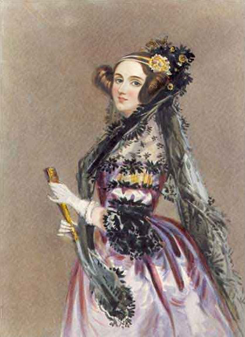
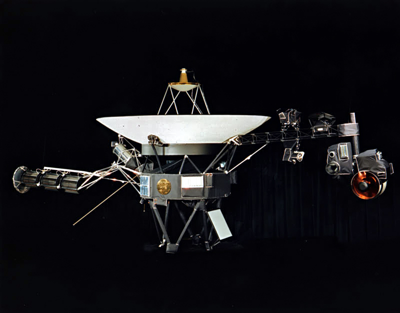

# Temas del curso

### 14/09 · Mis aficiones

Me gusta mucho jugar al tenis desde hace un par de años. Lo probé por hacer algo de deporte sin imaginarme que iba a llegar a ser algo tan significante en mi vida, porque cuando juego a tenis desconecto de todo lo demás, no pienso en nada más y me ayuda a despejar si tengo algún problema. Además, me encanta verme mejorar cada día y que cada día soy capaz de hacer cosas nuevas y estar más cerca de ser una jugadora importante. Mi mete es poder llegar a ser como Carlos Alcaraz y siento que cada día estoy más cerca.

Buscando en GitHub he encontrado [web de tenis](https://github.com/emilybache/Tennis-Refactoring-Kata) con normas para jugar a tenis.

---
### 30/09 · Premios Princesa de Asturias: Leo Messi

Leo Messi es uno de los futbolistas más importantes que existen hoy en día y que desde pequeño siempre mostró un gran talento en el fútbol. Comenzó jugando en el CF Barcelona, luego en el Paris Saint-Germain y por último en el Inter Miami CF. Además de que también formó parte de la Selección Argentina. Este año se retiró de su carrera como futbolista.
El jurado ha decidido darle a él el premio por su gran talento, su increíble trayectoria deportiva y por lo que hace para ayudar con la salud de los niños menos sanos, ya que el sufrió un problema de crecimiento. Además, de que es el futbolista con más premios y el que muestra mucho respeto, humildad y dedicación en el campo.
Yo escogí a Leo Messi por que me encantan los deportes y me parece una buena persona tanto con el resto del mundo como dentro del campo y eso es algo que pocos siguen haciendo. Creo que merece él el premio después de tanto esfuerzo.
[Su página en la Fundación](https://www.fpa.es/es/premios-princesa-de-asturias/premiados/2026-leo-messi/)

---
### 13/10 · Ada Lovelace
Ada es hija del famoso Lord Byron y de Anna Isabella Milbanke. Ada Lovelace fue una matemática y escritora británica que nació en Londres en 1815. Desde pequeña, le gustaban mucho las matemáticas y cuando tenía 18 años, conoció a Charles Babbage, un inventor. Ada colaboró con él y escribió una serie de instrucciones para que la máquina que fabricaba Charles pudiera realizar operaciones matemáticas. Murió en 1852 con 36 años, pero su figura se ha convertido en un ícono inspirador para las mujeres en la ciencia y la tecnología. Cada año, el segundo martes de octubre, se celebra el Día Internacional de Ada Lovelace para reconocer los logros de las mujeres en la ciencia y la tecnología, y destacar su importancia en la historia de la informática y la programación. En [Ada Lovelace en Wikipedia](https://es.wikipedia.org/wiki/Ada_Lovelace) encontrarás más información.

{: width="300"}

*Imagen de Ada Lovelace. Imagen: Alfred Edward Chalon, [Wikimedia Commons](https://commons.wikimedia.org/w/index.php?title=Special:Search&search=Ada+Lovelace&ns0=1&ns6=1&ns12=1&ns14=1&ns100=1&ns106=1#/media/File:Ada_lovelace.jpg)*

---

### 27/11 · Voyager 1

La Voyager 1 es una sonda espacial de la NASA que despegó el 5 de septiembre de 1977 para explorar los planetas exteriores. Ahora es noticia porque el 18 de noviembre de 2026 alcanzó una distancia de un día-luz de la Tierra, convirtiéndose en el objeto humano más lejano. Lleva un Disco de Oro con imágenes, música, sonidos naturales y saludos de nuestro planeta, pensado como mensaje para posibles civilizaciones extraterrestres. Puedes conocer más en [Voyager 1 en Wikipedia](https://es.wikipedia.org/wiki/Voyager_1).

| Dato | Voyager 1 |
|---|---|
| Lanzamiento | 5 de septiembre de 1977 |
| Distancia a la Tierra | 25.900.000.000 km |
| Velocidad | 61.000 km/h |
| Lo que tarda su señal en llegar | 24 horas |
| Años de viaje | 49 años |

{: width="300"}
*Modelo de la Voyager 1. Imagen: NASA/JPL-Caltech, [Wikimedia Commons](https://commons.wikimedia.org/wiki/File:Voyager.jpg)*

**Mi Disco de Oro 2026**

- **Lo que pondría:** Una fotografía de la Tierra vista desde el espacio, y la frase: «Vengan a visitarnos cuando tengan tiempo».
- **En qué idioma:** Español.
- **En qué formato:** Un disco digital con imágenes, música y grabaciones de voz.

---
